```console
$ nmap -sV -p- lucia.pan
Host is up (0.0092s latency).
 
PORT      STATE  SERVICE   INFO
22/tcp    open   ssh       Lucía Pan · Barcelona
53/udp    open   domain    Computer Engineering (IT) @ FIB-UPC, 4th year
443/tcp   open   https     AppSec Intern (G+D)
8080/tcp  open   http-alt  lucia-pcap.github.io
161/udp   open   snmp      skills 
179/tcp   open   bgp       certification roadmap 
25/tcp    open   smtp      contact 
 
Nmap done: 1 host up, 7 open ports.
```
 
### $ whoami
 
Hi! I’m Lucía, a fourth-year Computer Engineering student at FIB-UPC, currently working as an Application Security Intern. 
Passionate about cybersecurity and networks, and especially interested in cloud and post-quantum cryptography. I like understanding how things work, and how to break them.

Open to junior roles, internships and open-source projects related to cybersecurity, networks, cloud and backend development.
### $ show stack
 
**Languages**
 
[](https://skillicons.dev)
 
 
 
**Backend & data**
 
 
 
**Cloud & DevOps**
 
   
 
**Systems**
 
    
 
**Networks**
 
         
 
**Security**
 
    
 
### $ traceroute certifications
 
```console
 1  Introduction to Cybersecurity · Cisco Networking Academy   [completed]
 2  AWS Cloud Practitioner · Amazon Web Services               [in progress]
 3  CCNA · Cisco                                               [planned]
```
 
## $ ping -c 2 lucia.pan
```console
64 bytes from   pan.luciaa@gmail.com:        icmp_seq=1 ttl=64 time=0.0092 ms
64 bytes from   linkedin.com/in/luciaapan:   icmp_seq=2 ttl=64 time=0.0092 ms

--- lucia.pan ping statistics ---
2 packets transmitted, 2 received, 0% packet loss
```

 
🌐 [lucia-pcap.github.io](https://lucia-pcap.github.io/) · 💼 [LinkedIn](https://www.linkedin.com/in/luciaapan) · 📫 [pan.luciaa@gmail.com](mailto:pan.luciaa@gmail.com)
 
